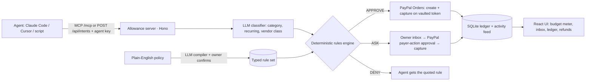

# Allowance

**A plain-English allowance for your AI agents, enforced at PayPal checkout.**

You write the rules once ("Monthly budget $100. Max $20 per purchase for APIs and data. No subscriptions. Ask me for anything over $50 or any new vendor."). Your agents (Claude Code, Cursor, custom) ask Allowance before they buy. Allowance approves and pays through PayPal, denies and quotes the rule, or sends you an approval card. The decision is made by deterministic, unit-tested code. An LLM only compiles your sentence into rules and extracts a few facts from each request.

## The problem

Agents now buy things: API credits, domains, SaaS seats, datasets, cloud. Today it is all-or-nothing. Either the agent holds your card (scary), or every purchase waits on you (slow). There is no middle layer that says "yes up to here, ask me past there, never for that".

## Who it's for

Developers, small teams and founders who run coding or ops agents and want them to spend money without handing over a card or approving every $12 domain.

## Why now

Agents are being given tools that can spend. Companies already pay for spend control for humans (Ramp, Brex), and agent-payments startups (Payman, Skyfire, Stripe Issuing for agents) show people want the agent version. Allowance is the policy and approval layer on top of a payment rail people already trust: PayPal.

## How it compares

| | Agent has your card | Ramp / Brex cards | Stripe Issuing for agents | Payman-style agent wallets | **Allowance** |
|---|---|---|---|---|---|
| Rules | none | per-card limits, merchant categories | programmatic controls you code | wallet limits | **plain English, compiled to typed rules you review** |
| Human in the loop | no | after the fact | you build it | varies | **built in: ASK → PayPal's own approval** |
| Explainable denial | no | decline code | decline code | varies | **quotes the rule and the source sentence** |
| Payment rail | your card | corporate card | issued cards | wallet | **your PayPal (Vault v3), refunds included** |
| Setup | none | company onboarding | build it | integration | **connect PayPal, write a sentence** |

(This is a positioning summary, not a feature audit of those products.)

## How PayPal is central

- **Vault v3**: the owner approves a *setup token* (`payment_source.paypal`, `usage_type: MERCHANT`, `permit_multiple_payment_tokens`) once on PayPal; the server exchanges it for a **payment token** (vault id). Auto-approved purchases are charged to it with no login each time.
- **Orders v2**: APPROVE creates a `CAPTURE` order charged to the vault id and captures it. The order id, capture id and status are stored in the ledger.
- **Payer-action approval**: ASK creates an order and the owner approves it on PayPal's own page (the `payer-action` link); the server captures on return. The agent sees the result.
- **Payments v2**: a Refund button on captured purchases calls the captures refund API.
- No PayPal response is ever faked in the product path. Without credentials the app shows a setup screen, and approved purchases are recorded as "payment failed: not connected" (with a Retry button).

## How AI is used (and where it is not)

- **Policy compiler** (`claude-sonnet-5-5`): plain English → typed JSON (`shared/policy.ts`, zod-validated). The UI shows each rule as a chip beside the sentence it came from (quotes are verified to be real substrings). You confirm before anything is enforced.
- **Intent classifier** (`claude-haiku-5-5`): extracts only category, recurring?, vendor class (gambling/crypto/adult) and a short quoted reason. Request text is treated as untrusted.
- **The decision is deterministic**: `shared/rules.ts` is a pure function (currency guard → vendor deny → blocked categories → subscriptions → caps → budget → approval conditions → approve). Blocked-category checks also run on the agent's own declared category, so a wrong LLM answer can't launder a blocked purchase.
- **No-LLM fallback**: without an AI key the policy editor offers structured inputs and classification uses the agent-declared category (labelled "declared" in the ledger). `OPENAI_API_KEY` works as an alternative provider. LLM calls are rate-limited (60/hour/IP, 400/day global); past the limit classification falls back as above.

## Architecture



Single Node process on port 4320: Hono API + MCP (streamable HTTP, stateless) + the built Vite/React app. Storage is Node's built-in `node:sqlite` (no native builds).

## The 2-minute demo

1. Start: `scripts/serve.sh`, open http://localhost:4320. Onboarding: **Connect PayPal** (approve once on the sandbox), **Write your policy** (the example is pre-filled; Compile, review the highlighted sentence-to-rule chips, Confirm), **Create an agent key**.
2. In a terminal: `ALLOWANCE_KEY=<key> npm run demo:agent` (or omit the key and it creates one). It fires three intents:
   - OpenAI $15 API credits → **APPROVE**, charged to your vaulted PayPal, appears in the ledger with its order and capture ids.
   - Coinbase $40 USDC → **DENY**, "Category crypto is blocked by your policy."
   - Lambda Labs $64 GPU credits → **ASK**, a phone-style card lands in the Inbox.
3. Open the Inbox, **Approve with PayPal**, finish on PayPal's sandbox page; you land back with the order captured.
4. Watch the budget meter move (alert banner and feed entry at 80%). Click **Refund** on a captured row.

## Setup

```bash
npm install
cp .env.example .env     # fill in the values below
scripts/serve.sh         # builds if needed, serves on http://localhost:4320
```

**PayPal sandbox** (free): developer.paypal.com → Apps & Credentials → Sandbox → Create App (Merchant) → copy Client ID and Secret into `.env` as `PAYPAL_CLIENT_ID` / `PAYPAL_CLIENT_SECRET`. Approve with a sandbox *personal* account (Sandbox → Accounts). Vault v3 and reference-transaction style charges may need to be enabled on the sandbox app/account; the PayPal error is shown in the UI if not.

| Env | Purpose |
|---|---|
| `PAYPAL_CLIENT_ID`, `PAYPAL_CLIENT_SECRET` | sandbox REST credentials (health-checked at startup) |
| `ANTHROPIC_API_KEY` | policy compiler + classifier (optional; `OPENAI_API_KEY` alternative) |
| `OWNER_PASSCODE` | if set, owner UI/API require it; agents still use their own keys |
| `PUBLIC_URL` | where PayPal redirects the browser back (default `http://localhost:4320`) |
| `PORT`, `DB_PATH` | default `4320`, `data/allowance.db` |

`scripts/serve.sh` also sources `/workspace/secrets/cto-anthropic.env` and an optional `/workspace/secrets/paypal-sandbox.env` if present.

## Connect Claude Code (MCP)

Create an agent key in **Agents**, then:

```bash
claude mcp add --transport http allowance http://localhost:4320/mcp \
  --header "Authorization: Bearer alw_YOUR_AGENT_KEY"
```

Tools: `request_purchase`, `get_allowance`, `list_my_purchases`, `get_purchase_status`. Cursor: add `{"mcpServers":{"allowance":{"url":"http://localhost:4320/mcp","headers":{"Authorization":"Bearer alw_…"}}}}`. REST: `POST /api/intents` with the same bearer key, `GET /api/intents/:id` to poll an ASK.

## Tests

```bash
npm test          # vitest: rules engine (all branches, budget math, month rollover, USD-only), policy schema, PayPal client (mocked fetch), rate limiter, no-AI/no-PayPal end-to-end
npm run typecheck
npm run build
```

## Honest limits

- The PayPal integration is written against the documented sandbox API and unit-tested with mocked `fetch`, but it has not yet been run against live sandbox credentials. Expect to tune request fields if PayPal's sandbox is stricter (e.g. vault-charge `stored_credential` values).
- Single owner, single policy, USD only. In-memory rate limiter and a process-local budget lock (one server instance).
- An owner-approved ASK is not re-checked against the budget.

Built for the PayPal AI Hackathon, Nov 2026. MIT licensed.
